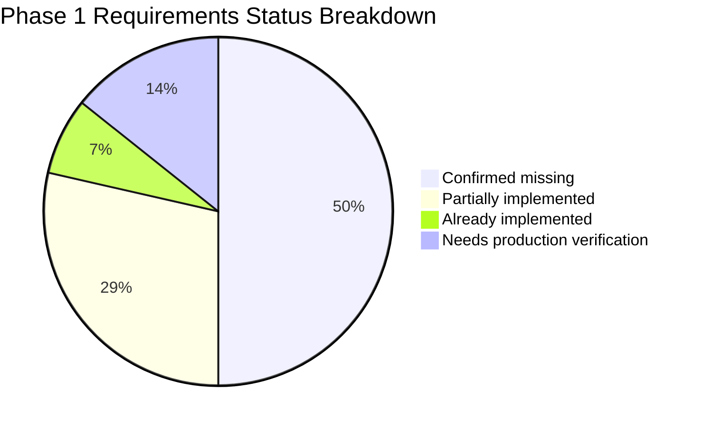
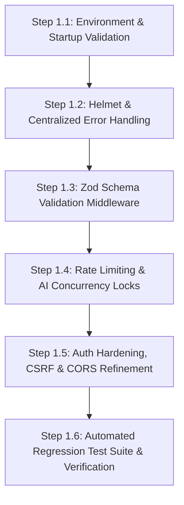

# Phase 1: Security and Abuse Prevention — Investigation and Implementation Plan

**Repository:** [https://github.com/Anuj-135/Resume-Analyser](https://github.com/Anuj-135/Resume-Analyser)  
**Live Application:** [https://resume-analyser-sooty-delta.vercel.app](https://resume-analyser-sooty-delta.vercel.app/)  
**Current Branch:** `main`  
**Current Commit:** `968bfe4b1003e5342b85038ec87317a44346543b` (date: `Tue Sep 29 12:27:37 2026 +0530`, message: `Readme Update`)  
**Investigation Date:** October 14, 2026  
**Status:** Investigation & Planning Only — No application code changed  

---

## 1. Executive Summary

An in-depth, code-level investigation of the Resume Analyser repository was conducted against the requirements of **Phase 1: Security and Abuse Prevention**.

### Key Highlights:
1. **Strong Architectural Foundations:** Ownership checks are already rigorously implemented across all resume and profile operations (`createResume`, `getResumes`, `getResumeById`, `deleteResume`, `deleteAllResumes`, `analyzeResume`, and `getProfileAnalytics`). Each query strictly scopes records by `req.userId` derived from the verified JWT. In-memory upload streaming to Cloudinary authenticated raw storage with short-lived signed URLs is fully in place. AI retry logic with exponential backoff and jitter is thoroughly tested and verified.
2. **Critical Security & Abuse Gaps:**
   - **Zero Rate Limiting:** Both authentication endpoints (`/api/auth/register`, `/api/auth/login`) and the expensive Gemini AI analysis endpoint (`/api/resumes/:id/analyze`) have no rate limiting, quotas, or concurrency locking. This leaves the system vulnerable to brute-force credential attacks, account spam, and catastrophic Gemini API quota/cost exhaustion.
   - **Missing HTTP Security Headers:** Helmet is absent. No CSP, HSTS, X-Content-Type-Options, or frame-guard headers are configured.
   - **Missing Centralized Error Handling & 404 Route:** Express default error handling is unhandled at the application boundary, creating risks of stack trace disclosure in non-production or improperly configured environments.
   - **Missing Request & Environment Validation:** No Zod schemas exist for request bodies, route parameters, or environment variables. Startup fails to validate critical secrets (`JWT_SECRET`, `GEMINI_API_KEY`, `CLOUDINARY_*`, `CLIENT_URL`).
   - **CSRF Exposure on Cross-Site Cookie Auth:** Because cross-origin cookies require `SameSite=None; Secure`, state-changing requests have no CSRF token or origin-verification defense.
   - **Cross-Site Cookie Vulnerability:** The frontend (Vercel) and backend (Render) operate across different top-level domains. Restrictive third-party cookie policies in Safari and modern Chrome risk dropping the session cookie.
3. **Automated Testing Deficit:** There are no automated tests for authentication, authorization, validation, rate limiting, or headers. `test_retry.js` is the sole functional automated test suite (7/7 pass). `test_phase5.js` is outdated and cannot be run safely against the current Cloudinary architecture.

---

## 2. Baseline Repository and Test Status

### 2.1 Git Working Tree & Structure
- **Branch:** `main` (up to date with `origin/main`)
- **Unstaged modified files:** `IMPLEMENTATION_PLAN.md` (uncommitted local changes by user)
- **Untracked files:** `Conversion_Plan.md` (retained untouched)
- **Root Directory:** No root `package.json`, root `.gitignore`, or `.github/workflows` directory exists.
- **Client Directory (`client/`):** Next.js 16.3.4 (App Router), React 19.2.8, Tailwind CSS v4, Lucide React, Zustand 5, Axios 1.20.0, react-dropzone.
- **Server Directory (`server/`):** Node.js / Express 5.2.1, Mongoose 9.9.5, bcrypt 6.0.0, jsonwebtoken 9.0.3, cloudinary 2.11.0, @google/genai 2.22.0, multer 2.3.0, pdf-parse 2.4.5.

### 2.2 Baseline Command Execution Results

| # | Command | Execution Directory | Exit Code | Actual Result / Output |
|---|---|---|---|---|
| 1 | `git status` | Root | `0` | Branch `main`, `IMPLEMENTATION_PLAN.md` modified, `Conversion_Plan.md` untracked. |
| 2 | `git log -1` | Root | `0` | Commit `968bfe4b1003e5342b85038ec87317a44346543b`, Author Anuj-135, message "Readme Update". |
| 3 | `npm --prefix client run lint` | Root | `0` | `eslint` passed with 0 errors and 15 warnings (warnings regarding `@next/next/no-img-element` for `` tags). |
| 4 | `npm --prefix client run build` | Root | `0` | Turbopack production build succeeded in 6.3s. Static pages generated (9/9). |
| 5 | `node server/test_retry.js` | Root | `0` | All 7 unit/service retry tests passed: immediate success, 503 retry, 503+429 retry, retry exhaustion, 403 non-retryable failure, schema validation, transient network error. |
| 6 | `node server/test_phase5.js` | Root | *Skipped* | **Not safe to run:** Script connects directly to `process.env.MONGODB_URI` without mocking, executes destructive `User.deleteMany` and `Resume.deleteMany`, and asserts that uploaded files exist on local disk (`server/uploads/`), which contradicts the current Cloudinary memory storage implementation. |
| 7 | `Test-Path .github` | Root | `0` (`False`) | CI workflow directory does not exist. No GitHub Actions configured. |

---

## 3. Detailed Investigation Findings (Classified)

Statuses used strictly per specification:
- **Confirmed missing**
- **Partially implemented**
- **Already implemented**
- **Needs production verification**
- **Not applicable / defer**



---

### Finding F-01: HTTP Security Headers and Helmet
- **Status:** Confirmed missing
- **Severity:** High
- **Relevant File & Location:** [server/server.js](file:///c:/Users/anuj%20chahar/OneDrive/Desktop/Projects/resume-analyser/server/server.js#L11-L18)
- **Evidence:** `server.js` only mounts `cors`, `cookieParser`, and `express.json()`. Helmet is not installed in `server/package.json` nor referenced anywhere in code.
- **Current Behavior:** Server emits responses without standard protection headers such as `Content-Security-Policy`, `Strict-Transport-Security`, `X-Content-Type-Options`, `X-Frame-Options`, `Referrer-Policy`, or `Cross-Origin-Resource-Policy`.
- **Risk & Failure Scenario:** Browsers can be tricked into MIME-sniffing responses; web pages can be framed in malicious iframes (clickjacking); missing HSTS allows downgrade attacks if HTTPS is not strictly enforced.
- **Recommended Change:** Install `helmet` in `server/package.json` and mount `app.use(helmet({ ... }))` configured for an API service, ensuring CORS headers and cross-origin resource sharing are not broken.
- **Required Tests:** Automated test asserting presence of `x-content-type-options: nosniff`, `x-frame-options: SAMEORIGIN` (or DENY), and `strict-transport-security`.
- **Changes Involved:** Dependency addition (`helmet`), API code change (`server.js`).

---

### Finding F-02: Zod Request & Environment Schema Validation
- **Status:** Confirmed missing
- **Severity:** High
- **Relevant File & Location:** [server/controllers/authController.js](file:///c:/Users/anuj%20chahar/OneDrive/Desktop/Projects/resume-analyser/server/controllers/authController.js#L26-L28), [server/controllers/resumeController.js](file:///c:/Users/anuj%20chahar/OneDrive/Desktop/Projects/resume-analyser/server/controllers/resumeController.js#L14-L16), [server/server.js](file:///c:/Users/anuj%20chahar/OneDrive/Desktop/Projects/resume-analyser/server/server.js)
- **Evidence:** Validation is ad-hoc:
  - `authController.js`: only checks `if (!name || !email || !password)` in `register` and `if (!email || !password)` in `login`. No email format check, no length limits.
  - `resumeController.js`: only checks `if (!companyName || !jobTitle || ...)`. Text length of `jobDescription` is completely unbounded.
  - Route parameters: uses `mongoose.Types.ObjectId.isValid(id)` inside controllers rather than validation middleware.
  - Environment variables: No validation schema at startup.
- **Current Behavior:** Malformed requests, oversized payload strings, or missing query parameters enter controller handlers directly.
- **Risk & Failure Scenario:** An attacker posts a 10MB string for `jobDescription` or invalid email formats, causing database bloat, AI token overruns, or unhandled runtime exceptions. Missing environment variables cause server crashes on specific route hits rather than failing fast at boot.
- **Recommended Change:** Install `zod` in `server/package.json`. Create a validation middleware `validateRequest({ body, query, params })` and startup environment validator `config/env.js`.
- **Required Tests:** Automated tests asserting 400 Bad Request with standardized error format for: invalid email, password too short (<8) or too long (>72), missing company name, invalid MongoDB ObjectId in URL params.
- **Changes Involved:** Dependency addition (`zod`), new middleware/schemas, API controller refactoring.

---

### Finding F-03: Rate Limiting for Authentication (Login and Registration)
- **Status:** Confirmed missing
- **Severity:** High
- **Relevant File & Location:** [server/routes/authRoutes.js](file:///c:/Users/anuj%20chahar/OneDrive/Desktop/Projects/resume-analyser/server/routes/authRoutes.js#L6-L9)
- **Evidence:** `authRoutes.js` binds `POST /register` and `POST /login` directly to controller actions with no rate limiting middleware. `express-rate-limit` is not installed.
- **Current Behavior:** Clients can submit unlimited login and registration requests without delay or threshold.
- **Risk & Failure Scenario:** Attackers can run automated brute-force password guessing dictionaries against user accounts or script millions of registrations, flooding MongoDB Atlas and consuming bcrypt CPU cycles.
- **Recommended Change:** Install `express-rate-limit`. Configure targeted limiters:
  - `authLimiter`: 10 requests per 15 minutes per IP for `/api/auth/login` and `/api/auth/register`.
  - Include standard `RateLimit-*` response headers and clear JSON error message `{ message: "Too many authentication attempts. Please try again later." }`.
  - Ensure reverse-proxy trust (`app.set('trust proxy', 1)`) is enabled for Render/cloud deployment so the real client IP is evaluated.
- **Required Tests:** Automated test verifying that the 11th consecutive request within the window receives HTTP 429 Too Many Requests.
- **Changes Involved:** Dependency addition (`express-rate-limit`), API route update (`authRoutes.js`), server configuration (`server.js`).

---

### Finding F-04: Rate Limits, Quotas, and Concurrency Locks for AI Analysis
- **Status:** Confirmed missing
- **Severity:** High
- **Relevant File & Location:** [server/routes/resumeRoutes.js](file:///c:/Users/anuj%20chahar/OneDrive/Desktop/Projects/resume-analyser/server/routes/resumeRoutes.js#L18), [server/controllers/resumeController.js](file:///c:/Users/anuj%20chahar/OneDrive/Desktop/Projects/resume-analyser/server/controllers/resumeController.js#L170-L242)
- **Evidence:** `POST /api/resumes/:id/analyze` is directly called without any rate limiter or concurrency guard. No daily quota per user is tracked in the database or cache.
- **Current Behavior:** A user can spam the "Analyze Resume" button or invoke the API repeatedly, triggering simultaneous calls to Google Gemini API (`@google/genai`).
- **Risk & Failure Scenario:** A single user sending rapid repeated requests can exhaust the project's Gemini API quota (triggering 429 for all users) and create runaway API billing. Concurrent analysis on the same resume record causes redundant processing and race conditions writing `feedback`.
- **Recommended Change:**
  - Implement a dedicated `analyzeLimiter` (e.g. max 5 analyses per user/IP per hour).
  - Implement an in-flight analysis lock per resume ID / user ID: if an analysis is currently executing for `resumeId`, subsequent calls return HTTP 409 Conflict `{ message: "Analysis already in progress for this resume" }` or wait.
  - Return HTTP 429 with `Retry-After` header when limits are exceeded.
- **Required Tests:** Automated tests asserting:
  1. Excessive calls to `/api/resumes/:id/analyze` receive 429.
  2. Concurrent duplicate calls to the same resume receive 409 Conflict.
- **Changes Involved:** Middleware / controller change (`resumeController.js`, `resumeRoutes.js`).

---

### Finding F-05: JWT Secret Validation, Algorithm Enforcement, and Expiry
- **Status:** Partially implemented
- **Severity:** Medium
- **Relevant File & Location:** [server/controllers/authController.js](file:///c:/Users/anuj%20chahar/OneDrive/Desktop/Projects/resume-analyser/server/controllers/authController.js#L13-L19), [server/middleware/auth.js](file:///c:/Users/anuj%20chahar/OneDrive/Desktop/Projects/resume-analyser/server/middleware/auth.js#L10-L16)
- **Evidence:**
  - Token signing uses `jwt.sign({ userId }, process.env.JWT_SECRET, { expiresIn: process.env.JWT_EXPIRES_IN || '7d' })`.
  - Token verification uses `jwt.verify(token, process.env.JWT_SECRET)`.
  - Gaps:
    - `JWT_SECRET` is never validated for presence or minimum entropy (e.g. >= 32 characters) at startup.
    - No algorithm is specified in `jwt.sign` or `jwt.verify` (should explicitly enforce `algorithms: ['HS256']`).
    - If `JWT_SECRET` is missing, `jwt.sign` throws at runtime instead of failing at startup.
- **Current Behavior:** Works when `JWT_SECRET` is present, but permits insecure or weak keys and does not lock down cryptographic algorithms.
- **Risk & Failure Scenario:** Weak secret keys can be cracked offline via hashcat; absence of algorithm pinning exposes systems to header algorithm confusion attacks.
- **Recommended Change:** Enforce minimum 32-character `JWT_SECRET` in startup validation. Pin `{ algorithms: ['HS256'] }` on both signing and verification.
- **Required Tests:** Automated tests asserting startup failure if `JWT_SECRET` is under 32 chars or missing; test token verification rejecting unexpected algorithms.
- **Changes Involved:** Validation schema (`config/env.js`), `authController.js`, `middleware/auth.js`.

---

### Finding F-06: Password Hashing, Length Bounds, and Timing Attack Mitigation
- **Status:** Partially implemented
- **Severity:** Medium
- **Relevant File & Location:** [server/controllers/authController.js](file:///c:/Users/anuj%20chahar/OneDrive/Desktop/Projects/resume-analyser/server/controllers/authController.js#L37-L44), [server/controllers/authController.js](file:///c:/Users/anuj%20chahar/OneDrive/Desktop/Projects/resume-analyser/server/controllers/authController.js#L74-L84)
- **Evidence:**
  - Password hashing uses `bcrypt.hash(password, 10)` (good).
  - Error messages for invalid email and wrong password are both `"Invalid email or password"` (good).
  - Gaps:
    - In `login`: If `!user`, it returns 401 immediately without executing a dummy bcrypt comparison. This introduces a measurable ~50-100ms timing difference between valid and invalid emails.
    - No password length upper bound: Bcrypt truncates at 72 bytes. Submitting massive password strings causes severe CPU starvation.
    - Duplicate registration: If `User.create` throws Mongo error `11000` due to concurrent identical registrations, it is caught as a generic 500 error instead of 409 Conflict.
- **Current Behavior:** Secure hashing in normal flow, but vulnerable to timing-based email enumeration and CPU DoS from oversized passwords.
- **Risk & Failure Scenario:** An attacker times HTTP responses to enumerate registered user email addresses; an attacker sends megabyte-sized passwords to exhaust server CPU.
- **Recommended Change:**
  - Limit password length to max 72 characters in validation schema.
  - Perform constant-time dummy hash comparison if user is not found.
  - Handle Mongo error `11000` gracefully as 409 Conflict.
- **Required Tests:** Automated tests for password length validation, duplicate email 409 response, and timing consistency.
- **Changes Involved:** `authController.js`, validation schema.

---

### Finding F-07: Production Cookie Attributes (httpOnly, Secure, SameSite)
- **Status:** Partially implemented
- **Severity:** High
- **Relevant File & Location:** [server/controllers/authController.js](file:///c:/Users/anuj%20chahar/OneDrive/Desktop/Projects/resume-analyser/server/controllers/authController.js#L5-L11), [server/controllers/authController.js](file:///c:/Users/anuj%20chahar/OneDrive/Desktop/Projects/resume-analyser/server/controllers/authController.js#L106-L111)
- **Evidence:**
  ```javascript
  const getCookieOptions = () => ({
    httpOnly: true,
    secure: process.env.NODE_ENV === 'production',
    sameSite: process.env.NODE_ENV === 'production' ? 'none' : 'lax',
    maxAge: 7 * 24 * 60 * 60 * 1000,
    path: '/',
  });
  ```
- **Current Behavior:** Correctly branches based on `NODE_ENV`. However:
  - `server/.env` does not specify `NODE_ENV`. If Render does not have `NODE_ENV=production` set, cookies will be issued as `secure: false, sameSite: 'lax'`, which modern browsers will immediately block on cross-site requests.
  - Even with `SameSite=None; Secure`, cross-site cookies between `vercel.app` and `onrender.com` are treated as third-party cookies by Safari (ITP) and modern Chrome, which can block session persistence.
- **Risk & Failure Scenario:** Deployed users log in successfully, but the browser discards the cookie or refuses to send it on subsequent Axios requests, causing all subsequent protected requests to return 401 Unauthorized.
- **Recommended Change:**
  - Mandate `NODE_ENV` validation at startup.
  - Add cookie configuration test suite.
  - Verify cross-site behavior on live deployment. (See Section 4 for alternative same-origin proxy design if third-party cookies are blocked).
- **Required Tests:** Automated tests asserting exact cookie flags in both `production` and `development` environments.
- **Changes Involved:** Startup validation (`config/env.js`), test suite.

---

### Finding F-08: CORS Origin Allowlist and Credentialed Requests
- **Status:** Partially implemented
- **Severity:** Medium
- **Relevant File & Location:** [server/server.js](file:///c:/Users/anuj%20chahar/OneDrive/Desktop/Projects/resume-analyser/server/server.js#L12-L15)
- **Evidence:**
  ```javascript
  app.use(cors({
    origin: process.env.CLIENT_URL || 'http://localhost:3000',
    credentials: true
  }));
  ```
- **Current Behavior:** Only supports a single origin string. If `CLIENT_URL` has a trailing slash, or if a user accesses via a Vercel preview URL (`https://resume-analyser-*-...vercel.app`), CORS rejects the request.
- **Risk & Failure Scenario:** Legitimate preview deployments or variations in `CLIENT_URL` (trailing slashes) completely break frontend-backend communication.
- **Recommended Change:** Update CORS middleware to accept an array of allowed origins (e.g., comma-separated in `CLIENT_URL` or regex matching production domain and preview URLs), normalize origins by stripping trailing slashes, and reject unapproved origins cleanly.
- **Required Tests:** Automated test asserting that approved origins receive correct CORS headers with credentials, while unapproved origins are blocked.
- **Changes Involved:** `server/server.js`.

---

### Finding F-09: CSRF Protection for Cookie-Authenticated Requests
- **Status:** Confirmed missing
- **Severity:** High
- **Relevant File & Location:** [server/server.js](file:///c:/Users/anuj%20chahar/OneDrive/Desktop/Projects/resume-analyser/server/server.js), [client/lib/axios.js](file:///c:/Users/anuj%20chahar/OneDrive/Desktop/Projects/resume-analyser/client/lib/axios.js)
- **Evidence:** Because `SameSite=None` is required for cross-site cookie transmission, browsers send the authentication cookie with any cross-site request unless blocked. Neither CSRF tokens nor custom header verification (e.g. `X-Requested-With` or custom origin validation) is implemented.
- **Current Behavior:** Any state-changing route (`POST /api/resumes`, `DELETE /api/resumes/:id`, `DELETE /api/resumes`, `POST /api/resumes/:id/analyze`) relies solely on the ambient `token` cookie.
- **Risk & Failure Scenario:** If a logged-in user visits a malicious website, that website could submit cross-site requests to delete the user's resumes or trigger expensive AI analysis.
- **Recommended Change:** Implement robust CSRF defense tailored to API architecture:
  - Custom header verification middleware on the server (`X-Requested-With: XMLHttpRequest`) combined with strict Origin checking for state-changing methods (`POST`, `PUT`, `DELETE`). Browsers prohibit cross-origin scripts from setting custom headers without CORS preflight approval.
- **Required Tests:** Automated test proving that a state-changing POST or DELETE request without the required CSRF protection header/token is rejected with HTTP 403 Forbidden.
- **Changes Involved:** Server middleware, `client/lib/axios.js`.

---

### Finding F-10: Ownership Checks Across All Resume Operations
- **Status:** Already implemented
- **Severity:** Informational / Verified Secure
- **Relevant File & Location:** [server/controllers/resumeController.js](file:///c:/Users/anuj%20chahar/OneDrive/Desktop/Projects/resume-analyser/server/controllers/resumeController.js#L40-L45), [server/controllers/resumeController.js](file:///c:/Users/anuj%20chahar/OneDrive/Desktop/Projects/resume-analyser/server/controllers/resumeController.js#L71), [server/controllers/resumeController.js](file:///c:/Users/anuj%20chahar/OneDrive/Desktop/Projects/resume-analyser/server/controllers/resumeController.js#L93), [server/controllers/resumeController.js](file:///c:/Users/anuj%20chahar/OneDrive/Desktop/Projects/resume-analyser/server/controllers/resumeController.js#L123), [server/controllers/resumeController.js](file:///c:/Users/anuj%20chahar/OneDrive/Desktop/Projects/resume-analyser/server/controllers/resumeController.js#L147), [server/controllers/resumeController.js](file:///c:/Users/anuj%20chahar/OneDrive/Desktop/Projects/resume-analyser/server/controllers/resumeController.js#L179), [server/controllers/profileController.js](file:///c:/Users/anuj%20chahar/OneDrive/Desktop/Projects/resume-analyser/server/controllers/profileController.js#L18)
- **Evidence:**
  - `createResume`: assigns `userId: req.userId`.
  - `getResumes`: `Resume.find({ userId: req.userId })`.
  - `getResumeById`: `Resume.findOne({ _id: id, userId: req.userId })`. Signed URL is only generated if this query succeeds.
  - `deleteResume`: `Resume.findOneAndDelete({ _id: id, userId: req.userId })`.
  - `deleteAllResumes`: `Resume.deleteMany({ userId: req.userId })`.
  - `analyzeResume`: `Resume.findOne({ _id: id, userId: req.userId })`.
  - `getProfileAnalytics`: `Resume.find({ userId: req.userId })`.
- **Current Behavior:** Strict tenant isolation is already enforced in every database query. User A cannot access, modify, analyze, download, or delete User B's resumes.
- **Risk:** Minimal. Implementation is correct.
- **Recommended Change:** Retain existing pattern; add automated authorization integration tests to guard against future regressions.
- **Required Tests:** Automated test verifying that User B receives 404 when querying, analyzing, or deleting User A's resume ID.
- **Changes Involved:** Test suite additions only.

---

### Finding F-11: Upload and Malformed PDF Defenses
- **Status:** Partially implemented
- **Severity:** Medium
- **Relevant File & Location:** [server/middleware/upload.js](file:///c:/Users/anuj%20chahar/OneDrive/Desktop/Projects/resume-analyser/server/middleware/upload.js#L21-L28), [server/controllers/resumeController.js](file:///c:/Users/anuj%20chahar/OneDrive/Desktop/Projects/resume-analyser/server/controllers/resumeController.js#L22-L29), [server/services/pdfService.js](file:///c:/Users/anuj%20chahar/OneDrive/Desktop/Projects/resume-analyser/server/services/pdfService.js#L28-L52)
- **Evidence:**
  - Multer memory storage limits `fileSize: 10 * 1024 * 1024` (10MB) and `files: 1`. (Implemented)
  - Magic-byte verification `buffer.subarray(0, 5).toString('utf8') === '%PDF-'`. (Implemented)
  - Empty text detection (422) and corrupted PDF detection (400) in `pdfService.js`. (Implemented)
  - Gaps:
    - `fetch(signedUrl)` in `pdfService.js` has no timeout abort signal; stalled Cloudinary downloads hang worker threads indefinitely.
    - No page limit or extracted character length limit: A 10MB PDF with 10,000 pages or a decompression bomb can monopolize CPU/RAM during `parser.getText()`.
    - No cap on extracted text length before passing to Gemini API (could exceed token thresholds).
    - `express.json()` in `server.js` has no explicit body size limit (defaults to 100kb, should be explicitly bounded e.g. 100kb).
- **Current Behavior:** Basic file type and size filtering works, but parsing and outbound network calls lack defensive timeouts and character/page caps.
- **Risk & Failure Scenario:** Malicious PDF hangs server worker threads; massive text payloads drive up AI token costs.
- **Recommended Change:** Add `AbortSignal.timeout(10000)` to Cloudinary fetch; add page count / character extraction cap (e.g., maximum 50,000 characters of extracted text); explicitly set `express.json({ limit: '100kb' })`.
- **Required Tests:** Automated tests for timeout abort, oversized text truncation/rejection, and non-PDF rejection.
- **Changes Involved:** `services/pdfService.js`, `server.js`.

---

### Finding F-12: Centralized Error Handling & Production Error Disclosure
- **Status:** Confirmed missing
- **Severity:** High
- **Relevant File & Location:** [server/server.js](file:///c:/Users/anuj%20chahar/OneDrive/Desktop/Projects/resume-analyser/server/server.js)
- **Evidence:** There is no error handling middleware (`app.use((err, req, res, next) => ...)`) and no 404 handler in `server.js`.
- **Current Behavior:** Unhandled errors, malformed JSON body errors, or unexpected promise rejections are handled by Express default error handler, emitting HTML pages with full stack traces in non-production environments. Hitting nonexistent routes returns Express default HTML `Cannot GET /api/xyz`.
- **Risk & Failure Scenario:** An attacker triggers a malformed JSON payload or internal error to inspect stack traces, disclosing server directory layout, dependency versions, or database details.
- **Recommended Change:** Implement a centralized error handling middleware:
  - Intercepts all errors, formats uniform JSON response `{ message: "...", code: "..." }`.
  - In production (`NODE_ENV === 'production'`), hides stack traces and internal messages for 500 errors.
  - Implement a 404 route handler returning JSON `{ message: "Route not found" }`.
- **Required Tests:** Automated test verifying that throwing an error returns structured JSON and never leaks `stack` when `NODE_ENV=production`.
- **Changes Involved:** Middleware creation (`middleware/errorHandler.js`), `server.js`.

---

### Finding F-13: Environment Variable Startup Validation
- **Status:** Confirmed missing
- **Severity:** High
- **Relevant File & Location:** [server/server.js](file:///c:/Users/anuj%20chahar/OneDrive/Desktop/Projects/resume-analyser/server/server.js#L42-L55), [server/config/db.js](file:///c:/Users/anuj%20chahar/OneDrive/Desktop/Projects/resume-analyser/server/config/db.js#L3-L6)
- **Evidence:** Only `MONGODB_URI` is checked in `db.js`. Other mandatory variables (`JWT_SECRET`, `CLIENT_URL`, `GEMINI_API_KEY`, `CLOUDINARY_CLOUD_NAME`, `CLOUDINARY_API_KEY`, `CLOUDINARY_API_SECRET`, `NODE_ENV`) are not validated at startup.
- **Current Behavior:** The server starts up successfully even if critical credentials or configurations are completely missing, failing only when a user triggers the associated functionality.
- **Risk & Failure Scenario:** Server deploys with a missing `GEMINI_API_KEY` or `JWT_SECRET`; deployment passes health checks, but all user registrations, logins, or analyses fail unexpectedly.
- **Recommended Change:** Create `config/env.js` using Zod to parse and validate `process.env` before starting the server. If any required variable is missing or invalid, print sanitized error names and exit immediately (`process.exit(1)`).
- **Required Tests:** Automated test asserting that missing `JWT_SECRET` causes startup validation to fail.
- **Changes Involved:** New file `server/config/env.js`, updated `server/server.js`.

---

### Finding F-14: Automated Test Suite and Regression Harness
- **Status:** Confirmed missing
- **Severity:** High
- **Relevant File & Location:** [server/package.json](file:///c:/Users/anuj%20chahar/OneDrive/Desktop/Projects/resume-analyser/server/package.json#L6-L9), [server/test_retry.js](file:///c:/Users/anuj%20chahar/OneDrive/Desktop/Projects/resume-analyser/server/test_retry.js), [server/test_phase5.js](file:///c:/Users/anuj%20chahar/OneDrive/Desktop/Projects/resume-analyser/server/test_phase5.js)
- **Evidence:**
  - `server/package.json` has no `"test"` script.
  - `test_retry.js` is isolated and only tests AI retries (passes 7/7).
  - `test_phase5.js` is outdated (references local disk paths `uploads/`) and executes destructive database queries.
  - No automated tests exist for auth, CORS, security headers, rate limiting, or input validation.
- **Current Behavior:** Developers cannot run a single standardized test command (`npm test`) to verify system security or functionality before deployment.
- **Risk & Failure Scenario:** Regressions in auth, authorization, or security rules escape to production undetected.
- **Recommended Change:** Add a lightweight, fast test harness using Node's built-in test runner (`node:test`) or custom test harness and configure `"test": "node --test tests/*.test.js"` in `server/package.json`.
- **Required Tests:** Full integration test suite covering auth, headers, rate limits, Zod validation, and ownership.
- **Changes Involved:** `server/package.json`, test suite files.

---

### Finding F-15: Cross-Site Cookie Delivery in Production (Chrome / Safari)
- **Status:** Needs production verification
- **Severity:** High
- **Relevant File & Location:** Deployed Architecture (Vercel Frontend + Render Backend)
- **Evidence:** Frontend is deployed at `https://resume-analyser-sooty-delta.vercel.app`. API is hosted on Render (`onrender.com`).
- **Current Behavior / Risk:** Because the domains are completely different (`.vercel.app` vs `.onrender.com`), browsers treat the authentication cookie as a third-party cookie. Safari's ITP (Intelligent Tracking Prevention) and Google Chrome's third-party cookie phaseout block third-party cookies by default or partition them. This causes the login cookie to be dropped, rendering the user perpetually unauthenticated.
- **Verification Plan:** Manually verify live login, session restoration on refresh, and navigation across Safari, Chrome (incognito / third-party cookies disabled), and Firefox.

---

### Finding F-16: Live Production Security Headers and Rate Limits
- **Status:** Needs production verification
- **Severity:** Medium
- **Relevant File & Location:** Live deployment at Render / Vercel
- **Evidence:** Live API endpoint URL needs to be confirmed and inspected for edge CDN headers (e.g. Render edge headers, Vercel edge headers).
- **Verification Plan:** Send `curl -I` / GET requests to the live backend `/api/health` once identified to record actual deployed headers.

---

## 4. Proposed Scope & Implementation Sequence for Phase 1

To keep changes small, safe, and verifiable, Phase 1 is divided into **6 ordered implementation steps**:



### Step 1.1 — Environment Variable & Safe Startup Validation
- **Goal:** Prevent server from starting with missing, weak, or insecure configurations.
- **Files to change/add:**
  - `server/config/env.js` (new file): Define Zod schema validating `PORT`, `NODE_ENV`, `MONGODB_URI`, `JWT_SECRET` (min 32 chars), `JWT_EXPIRES_IN`, `CLIENT_URL`, `GEMINI_API_KEY`, `GEMINI_MODEL`, `CLOUDINARY_CLOUD_NAME`, `CLOUDINARY_API_KEY`, `CLOUDINARY_API_SECRET`.
  - `server/server.js`: Import `config/env.js` at the very top. Cleanly exit if validation fails without logging secret values.
- **Dependencies:** Add `zod` to `server/package.json`.

### Step 1.2 — Security Headers & Centralized Error Handling
- **Goal:** Ensure all responses carry security headers and internal errors never disclose stack traces.
- **Files to change/add:**
  - `server/middleware/errorHandler.js` (new file): Centralized error middleware handling Zod errors (400), Multer errors (400), JWT errors (401), and internal server errors (500, sanitized in production).
  - `server/server.js`: Mount `helmet()` with API-friendly configuration (e.g. `crossOriginResourcePolicy: { policy: "cross-origin" }`), mount 404 JSON catch-all, and register `errorHandler`.
- **Dependencies:** Add `helmet` to `server/package.json`.

### Step 1.3 — Zod Request Validation Middleware
- **Goal:** Validate request bodies, route parameters, and query parameters before reaching business logic.
- **Files to change/add:**
  - `server/middleware/validate.js` (new file): Generic middleware `validateRequest({ body, query, params })`.
  - `server/schemas/authSchemas.js` (new file): Register schema (email format, password min 8 max 72 chars, name min 1 max 100), Login schema.
  - `server/schemas/resumeSchemas.js` (new file): Create resume schema (companyName max 100, jobTitle max 100, jobDescription max 20,000 chars), ObjectId param schema.
  - `server/routes/authRoutes.js`: Attach validation middleware to `/register` and `/login`.
  - `server/routes/resumeRoutes.js`: Attach validation middleware to `/`, `/:id`, `/:id/analyze`.

### Step 1.4 — Rate Limiting & AI Concurrency Guard
- **Goal:** Protect against auth brute-forcing and uncontrolled Gemini API spending.
- **Files to change/add:**
  - `server/middleware/rateLimiter.js` (new file):
    - `authLimiter`: 10 requests / 15 minutes per IP for `/api/auth/login` and `/api/auth/register`.
    - `analyzeLimiter`: 5 requests / hour per user/IP for `/api/resumes/:id/analyze`.
  - `server/controllers/resumeController.js`:
    - Add an active analysis tracking set/map to reject concurrent duplicate analysis requests on the same `resumeId` with 409 Conflict.
  - `server/services/pdfService.js`:
    - Add `AbortSignal.timeout(10000)` to Cloudinary fetch.
    - Bound extracted text to max 50,000 characters before returning to controller.
- **Dependencies:** Add `express-rate-limit` to `server/package.json`.

### Step 1.5 — Auth Hardening, CSRF Defense & CORS Refinement
- **Goal:** Protect against timing attacks, CSRF forgery, and multi-origin CORS issues.
- **Files to change/add:**
  - `server/controllers/authController.js`:
    - Perform dummy bcrypt comparison on failed login to eliminate timing enumeration.
    - Enforce algorithm pinning `{ algorithms: ['HS256'] }`.
    - Catch Mongo duplicate key error 11000 and return 409 Conflict.
  - `server/middleware/csrf.js` (new file):
    - Require a custom header `X-Requested-With: XMLHttpRequest` on all state-changing requests (`POST`, `PUT`, `DELETE`). Cross-origin websites cannot attach custom headers without preflight approval.
  - `client/lib/axios.js`:
    - Attach default header `'X-Requested-With': 'XMLHttpRequest'`.
  - `server/server.js`:
    - Update CORS config to trim trailing slashes and cleanly handle allowed origins.

### Step 1.6 — Automated Regression Test Harness
- **Goal:** Verify all security defenses programmatically and provide a clean `npm test` script.
- **Files to change/add:**
  - `server/tests/security.test.js` (new file): Test suite covering:
    - Security headers presence (Helmet).
    - Zod validation rejections (bad email, short password, invalid ObjectId).
    - Rate limiting triggering 429.
    - CSRF protection rejecting unadorned state-changing requests.
    - Multi-tenant authorization (User A cannot access User B's resume).
    - Error handler hiding stack trace in production.
  - `server/package.json`: Add `"test": "node --test tests/*.test.js"` script.

---

## 5. Exact Files Expected to Change

| File Path | Action | Rationale |
|---|---|---|
| `server/package.json` | Modify | Add `helmet`, `zod`, `express-rate-limit` dependencies; add `"test"` script. |
| `server/package-lock.json` | Modify | Lockfile update for new dependencies. |
| `server/config/env.js` | Create | Zod validation schema for startup environment variables. |
| `server/server.js` | Modify | Mount helmet, CORS refinement, trust proxy setting, 404 handler, error handler. |
| `server/middleware/errorHandler.js` | Create | Centralized JSON error response handler hiding stack traces in production. |
| `server/middleware/validate.js` | Create | Reusable Zod validation middleware for bodies, params, queries. |
| `server/middleware/rateLimiter.js` | Create | Express-rate-limit configurations for auth and AI analysis. |
| `server/middleware/csrf.js` | Create | Header-based CSRF protection for cookie-authenticated state-changing requests. |
| `server/schemas/authSchemas.js` | Create | Zod schemas for register, login. |
| `server/schemas/resumeSchemas.js` | Create | Zod schemas for resume creation and ObjectId parameters. |
| `server/controllers/authController.js` | Modify | Algorithm pinning, timing attack dummy hash, Mongo 11000 handling. |
| `server/controllers/resumeController.js` | Modify | In-flight analysis locking to prevent concurrent duplicate AI spend. |
| `server/services/pdfService.js` | Modify | Add fetch timeout and extracted text length bounds. |
| `server/routes/authRoutes.js` | Modify | Attach auth rate limiter and Zod validation middleware. |
| `server/routes/resumeRoutes.js` | Modify | Attach AI rate limiter, CSRF middleware, and Zod param validation. |
| `client/lib/axios.js` | Modify | Add custom CSRF protection header (`X-Requested-With`). |
| `server/tests/security.test.js` | Create | Comprehensive security regression integration tests. |

---

## 6. Proposed Dependency Additions

| Package | Location | Version Target | Justification |
|---|---|---|---|
| `helmet` | `server/package.json` | `^8.0.0` | Standard, minimal HTTP security headers middleware (HSTS, CSP, nosniff, frameguard). |
| `zod` | `server/package.json` | `^3.24.0` | Strict, composable schema validation for requests and environment variables. |
| `express-rate-limit` | `server/package.json` | `^7.5.0` | Production-standard IP and key-based rate limiting middleware. |

*Note: No client-side dependencies are added. No unnecessary databases, Redis, or queue infrastructures are introduced.*

---

## 7. Environment Variable & Deployment Considerations

### 7.1 Backend Environment Variables (`server/.env`)
Required variables validated at startup:
- `PORT` (optional, default: `5000`)
- `NODE_ENV` (required: `'development'` | `'production'`)
- `MONGODB_URI` (required: valid MongoDB URI)
- `CLIENT_URL` (required: allowed frontend origin(s))
- `JWT_SECRET` (required: minimum 32 characters)
- `JWT_EXPIRES_IN` (optional, default: `'7d'`)
- `GEMINI_API_KEY` (required: Google AI Studio key)
- `GEMINI_MODEL` (optional, default: `'gemini-3.8-flash'`)
- `CLOUDINARY_CLOUD_NAME` (required)
- `CLOUDINARY_API_KEY` (required)
- `CLOUDINARY_API_SECRET` (required)

### 7.2 Hosting Platform Settings
- **Render (Backend):** Must ensure `NODE_ENV=production` is explicitly set in Render Environment settings. `app.set('trust proxy', 1)` must be enabled in Express so rate limiting sees real client IPs instead of Render proxy IPs.
- **Vercel (Frontend):** `NEXT_PUBLIC_API_URL` must point to the Render backend URL.

---

## 8. Security Considerations & Compatibility Risks

1. **Cross-Site Cookie Blocking in Safari/Chrome:**
   - *Risk:* With the frontend on Vercel (`vercel.app`) and backend on Render (`onrender.com`), third-party cookie blocking will prevent `token` from being included in requests.
   - *Mitigation & Decision:* Test thoroughly on deployed environment. If blocked, the recommended architecture is configuring Next.js API rewrites (`next.config.mjs`) to proxy `/api/*` requests to the Render backend under the same origin (`resume-analyser-sooty-delta.vercel.app/api/*`), transforming cookies from cross-site to first-party (`SameSite=Lax`).
2. **CORS Breaking on Previews:**
   - *Risk:* Hardcoded single origin in `CLIENT_URL` breaks Vercel preview branch deployments.
   - *Mitigation:* Allow comma-separated origins or a regex matcher for authorized domains in the CORS origin resolver.
3. **Helmet Header Interference:**
   - *Risk:* Strict `Cross-Origin-Resource-Policy` or `Cross-Origin-Embedder-Policy` could block signed Cloudinary PDF previews in iframes or new tabs.
   - *Mitigation:* Explicitly configure `crossOriginResourcePolicy: { policy: "cross-origin" }`.

---

## 9. Comprehensive Test Plan

### 9.1 Unit & Middleware Tests
- **Environment validation:** Assert startup succeeds with valid config and throws informative errors when `JWT_SECRET` or `MONGODB_URI` is missing.
- **Request validation (Zod):**
  - Registration with invalid email format returns 400.
  - Registration with 5-character password returns 400.
  - Resume creation with blank company name returns 400.
  - Request with malformed ObjectId param (`/api/resumes/123invalid`) returns 400.
- **Rate limiting:**
  - Send 11 rapid requests to `/api/auth/login` → 11th request returns 429 Too Many Requests with retry header.
  - Send 6 rapid requests to `/api/resumes/:id/analyze` → 6th request returns 429.

### 9.2 Security & Negative Tests
- **CSRF defense:** Send `POST /api/resumes` without `X-Requested-With` header → returns 403 Forbidden.
- **Security headers:** Inspect response headers of `GET /api/health` → verify `x-content-type-options: nosniff`, `x-frame-options`, and `strict-transport-security`.
- **Error sanitization:** Force a 500 server error while `NODE_ENV=production` → response body contains `{ message: "Internal server error" }` and zero stack trace traces.

### 9.3 Multi-Tenant Authorization Tests
- Create User A and User B.
- Upload Resume 1 under User A.
- Attempt to fetch Resume 1 as User B (`GET /api/resumes/:resume1Id`) → returns 404 Not Found.
- Attempt to analyze Resume 1 as User B (`POST /api/resumes/:resume1Id/analyze`) → returns 404 Not Found.
- Attempt to delete Resume 1 as User B (`DELETE /api/resumes/:resume1Id`) → returns 404 Not Found.
- Verify Resume 1 remains intact in database.

### 9.4 Regression Tests
- Existing valid registration, login, `/me` profile fetch, and logout flows continue to function seamlessly.
- Existing AI retry tests in `test_retry.js` continue to pass (7/7).

---

## 10. Acceptance Criteria

Phase 1 will be considered complete only when:
1. All missing security headers (Helmet) are confirmed present on API responses.
2. Zod validation rejects invalid inputs (bad emails, invalid IDs, missing required fields, oversized text) with clean 400 JSON responses.
3. Rapid repeated requests to auth and AI analysis endpoints are throttled with 429 responses.
4. Concurrent duplicate analysis calls on the same resume return 409 Conflict.
5. All state-changing endpoints reject forged requests lacking the CSRF defense header.
6. Centralized error handling catches all unhandled errors and hides stack traces in production.
7. Automated integration test suite (`npm test` in `server/`) executes cleanly with 100% pass rate.
8. No application functionality regressions are observed.

---

## 11. Rollback Approach

If issues arise during rollout:
1. **Code Rollback:** All Phase 1 changes are confined to `server/` and `client/lib/axios.js`. A single Git revert (`git revert <commit>`) cleanly rolls back all middleware and schema additions.
2. **Configuration Rollback:** If rate limits cause false positives on shared NAT IPs, rate limiter thresholds can be relaxed via environment variables or disabled per-route without database migration.
3. **Zero Database Impact:** Phase 1 introduces no schema changes, index changes, or data migrations. The database remains 100% backward-compatible.

---

## 12. Items Explicitly Deferred to Later Phases

- **Phase 2 (Persistent Storage & Data Integrity):** Migration/cleanup of legacy local `uploads/` files on disk, storage reconciliation for orphaned Cloudinary assets, and resume history pagination.
- **Phase 3 (AI Reliability):** Prompt injection defense delimiters, prompt evaluation benchmarking, and background worker queue investigation.
- **Phase 4 (Automated Tests & CI/CD):** GitHub Actions workflows, automated lint/build CI pipelines, and Cloudinary test mocking.
- **Phase 5 (Frontend UX & Accessibility):** Redesigning empty states, score explanations, and visual loading skeletons.
- **Phase 6 (README & Polish):** Documentation refresh, architecture diagrams, and screenshot updates.

---

## 13. Questions Requiring User Decision

1. **Rate Limiting Thresholds:**
   - Proposed: 10 login/register attempts per 15 minutes per IP; 5 AI analyses per user per hour.
   - *Decision:* Are these thresholds acceptable, or would you prefer different limits?
2. **CSRF Strategy:**
   - Proposed: Custom header verification (`X-Requested-With: XMLHttpRequest`) enforced on all state-changing API endpoints (`POST`, `PUT`, `DELETE`). This is lightweight, standard for SPA/API architectures, and requires no session state.
   - *Alternative:* Double-submit cookie pattern with `csrf-csrf`.
   - *Decision:* Do you approve the custom header verification approach?
3. **Cross-Site Cookie Architecture vs Same-Origin Proxy:**
   - The current setup relies on cross-site cookies (`SameSite=None; Secure`) between Vercel and Render.
   - If Safari or Chrome blocks third-party cookies on the live domain, would you approve configuring Next.js API rewrites (`next.config.mjs`) to proxy `/api/*` requests through Vercel to Render, making authentication 100% first-party (`SameSite=Lax`)?
